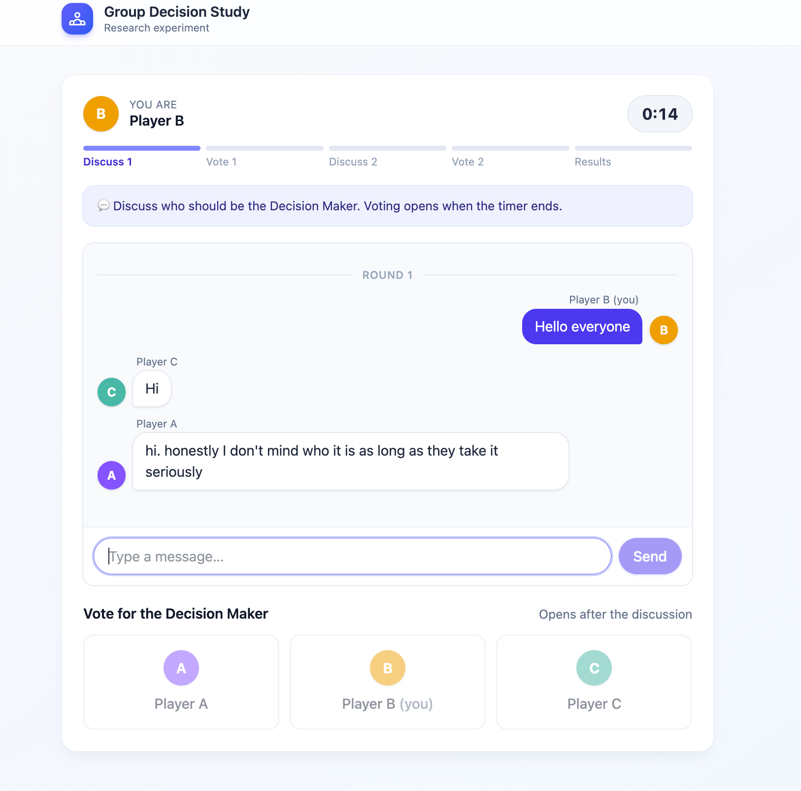
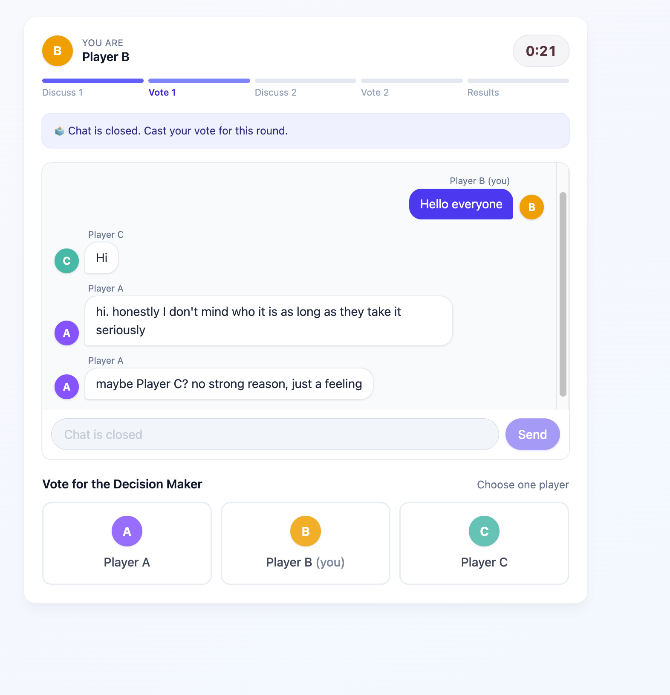
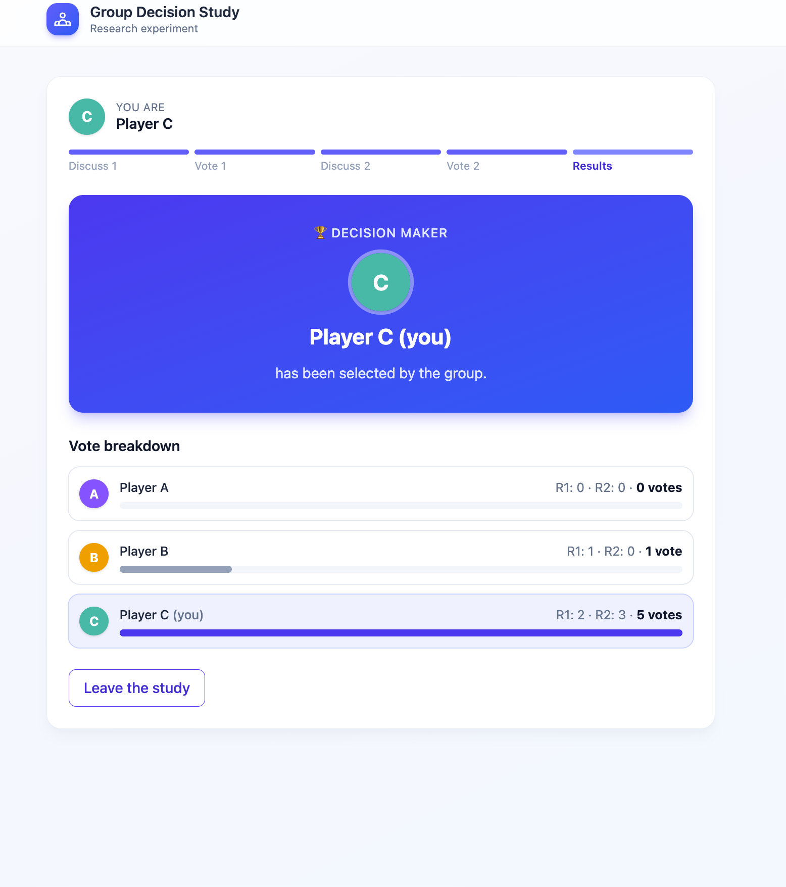

# Group Decision Experiment

A real-time web app for a three-participant group decision experiment. Players
appear only as **Player A / B / C**. They discuss for two rounds and vote after
each round to elect a **Decision Maker**. Seats can be filled by humans or
rule-based AI agents, and participants can't tell which is which.

**Stack:** React + TypeScript (Vite) + Tailwind CSS v4 · FastAPI · PostgreSQL · Docker Compose

| Discussion | Voting | Results |
| :---: | :---: | :---: |
|  |  |  |

## Getting started

Requires Docker.

```bash
git clone https://github.com/pscon/chm-decision-experiment.git
cd chm-decision-experiment
docker compose up --build
```

Open **http://localhost:8080**. To play as several participants on one
machine, open each one in its **own tab or private window** and click *Join the
study*. Refreshing a tab keeps your seat.

Run the unit tests (result tally, chat/vote validation, concurrent joins,
anonymity, config and agents):

```bash
docker compose run --rm --no-deps backend python -m pytest -q
```

## Configuration

Edit [`config.yml`](config.yml), then run `docker compose restart backend`.

| Condition       | `participants`          |
| --------------- | ----------------------- |
| 3 humans        | `[human, human, human]` |
| 2 humans + 1 AI | `[human, human, ai]`    |
| 1 human + 2 AIs | `[human, ai, ai]`       |

`discussion_seconds` (default 60) and `voting_seconds` (default 20) set the
timings.

## How it works

- **Flow:** `waiting → discussion 1 → voting 1 → discussion 2 → voting 2 →
  results`. The server drives the phases with one task per session and pushes
  state over WebSockets. The browser countdown uses the server's deadline.
- **Identity:** `POST /api/join` returns an opaque token. The server works out
  the player from that token, so clients never choose their own label.
- **Validation:** the server only accepts chat during discussion (max 300
  chars) and one vote per round during voting. Duplicate votes are also blocked
  by a `UNIQUE(session, round, voter)` database constraint.
- **Concurrency:** a lock around joins prevents overfilled sessions. Votes
  never advance the phase themselves, so a phase can't be skipped twice.
- **Storage:** sessions (with a config snapshot), participants, messages and
  votes are stored in PostgreSQL.

Key files: [`game.py`](backend/app/game.py) (flow and validation),
[`agents.py`](backend/app/agents.py) (AI agents),
[`results.py`](backend/app/results.py) (tally),
[`useExperiment.ts`](frontend/src/hooks/useExperiment.ts) (WebSocket client).

## Design decisions

**Result and tie-break.** Votes from both rounds are added up and the most
votes wins. A tie goes to the round-2 votes among the tied players, then to
player order (A → B → C). Round-1 counts stay hidden until the final screen.
Self-votes are allowed.

**Keeping AI seats hidden.** Participant types exist only on the server. They
never appear in API responses, WebSocket messages or the UI. Seat types are
mapped to shuffled labels each session, and the waiting room doesn't show how
many people are still missing.

**Simulated agents.** These are rule-based and need no API key. Each agent:

- starts with a random favourite
- sends 2–3 templated messages per round
- replies when it's mentioned
- tends to agree with suggestions
- votes after a short delay for whoever has the most support in the chat

Agents go through the same checks as humans.

**Edge cases.**
- *Refresh:* the token is kept in `sessionStorage`, so the player rejoins with
  the full state.
- *Disconnect:* the client reconnects automatically, and the game keeps going.
- *Missing votes:* voting closes early once all 3 votes are in. Otherwise it
  closes after `voting_seconds`, and missing votes count as abstentions.
- *Server restart:* sessions that were running are marked `aborted`.

## Trade-offs

- A single backend process with live state in memory. Scaling out would need
  shared state (e.g. Redis) and resumable sessions.
- Seats aren't released if someone leaves the waiting room (no heartbeat).
- No authentication, admin/export UI or chat rate limiting.
- Agent messages are templated and can repeat. An LLM could plug into
  `RuleBasedAgent.compose()`.

## AI usage

See [`ai_prompts.md`](ai_prompts.md).

## Author

Developed by [Paul Ekunola](https://www.linkedin.com/in/paul-ekunola).
